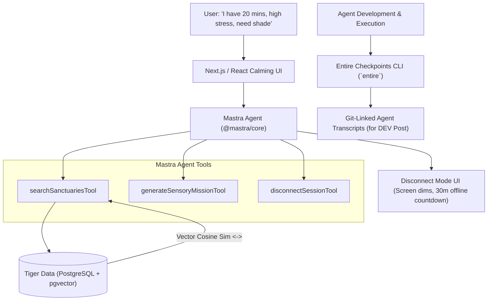

# Implementation Plan & Master Agent Prompt: GroundTrace

## Goal Description
Build **GroundTrace**, an AI-powered micro-sanctuary discovery agent and outdoor disconnect companion designed for the **Hacktoberfest Open-Source AI Challenge: Week 1 ("Touch Grass")** on DEV Community. 

GroundTrace addresses screen fatigue for developers and remote workers by finding quiet, hidden nature spots ("micro-sanctuaries") within a 5-to-15 minute walk. Once a spot is recommended, GroundTrace initiates a physical "Disconnect Lockout" mode—closing or dimming the screen with an offline timer to ensure screen interaction is the shortest part of the journey.

GroundTrace specifically category-stacks the three lowest-competition partner tracks:
1. **Best Use of Mastra** (TypeScript agent workflows, tools, and memory) — 3 competing entries.
2. **Best Use of Tiger Data** (PostgreSQL with `pgvector` for semantic spatial matching) — 3 competing entries.
3. **Best Use of Entire** (Checkpoints CLI capturing agent development & runtime transcripts) — 3 competing entries.

---

## User Review Required
> [!IMPORTANT]
> **LLM & Embedding API Key Choice**: GroundTrace's Mastra agent requires an LLM and an embedding model. By default, this plan configures the **Google Gemini API** (`gemini-2.5-flash` and `text-embedding-004`) via Google AI Studio's free tier, with a simple fallback to OpenAI or local Ollama. Please confirm if Gemini is your preferred free LLM provider.

> [!NOTE]
> **Database Provisioning**: Tiger Data provides a free PostgreSQL cloud instance with `pgvector` pre-enabled. The plan includes an automated seed script (`seed.ts`) pre-populated with realistic urban micro-sanctuary data so the project works immediately upon adding your `DATABASE_URL`.

---

## Architecture & Technology Stack



* **Frontend**: Next.js 15 (App Router), Tailwind CSS, Lucide icons, Framer Motion (earthy, minimalist botanical theme).
* **Agent Framework**: `@mastra/core` (TypeScript).
* **Database**: Tiger Data (Tiger Cloud / Timescale PostgreSQL with `pgvector`).
* **Session Recording / Submission Qualifier**: Entire Checkpoints CLI (`entire`).
* **Embedding Model**: Gemini `text-embedding-004` (768 dimensions) or OpenAI `text-embedding-3-small`.
* **Reasoning Model**: `gemini-2.5-flash` or `gpt-4o-mini`.

---

## Proposed Project Structure

```
groundtrace/
├── package.json
├── tsconfig.json
├── .env.example
├── README.md
├── src/
│   ├── app/
│   │   ├── layout.tsx
│   │   ├── page.tsx
│   │   ├── api/
│   │   │   └── agent/
│   │   │       └── route.ts          # API route invoking Mastra Agent
│   ├── components/
│   │   ├── SanctuaryCard.tsx         # Clean display of recommended spot
│   │   ├── DisconnectModal.tsx       # Fullscreen dark timer encouraging walk
│   │   └── MoodSelector.tsx          # Quick chips: stressed, need sun, quiet
│   ├── db/
│   │   ├── client.ts                 # PostgreSQL connection pool (pg)
│   │   ├── schema.sql                # pgvector table & index definition
│   │   └── seed.ts                   # Seeds 15+ curated micro-sanctuaries
│   └── mastra/
│       ├── index.ts                  # Mastra instance definition
│       ├── agents/
│       │   └── sanctuaryAgent.ts     # Core GroundTrace Agent
│       └── tools/
│           ├── searchSanctuaries.ts  # Tiger Data pgvector similarity search
│           └── sensoryMission.ts     # Creates screen-free outdoor prompt
└── entire.yaml                       # Entire CLI configuration
```

---

## The Master Agent Prompt (For Delegated Agent Execution)

Copy and provide the prompt below to an autonomous coding agent to build GroundTrace from scratch:

````markdown
# MASTER BUILD PROMPT: GroundTrace (Hacktoberfest 2026 AI Challenge)

## Role
You are a senior full-stack AI engineer. You are building **GroundTrace**, an open-source AI micro-sanctuary discovery agent and outdoor disconnect companion targeting the **Hacktoberfest 2026 Open-Source AI Challenge: Week 1 ("Touch Grass")** on DEV Community.

## Core Objective & Philosophy
Developers spend 10+ hours a day behind screens. GroundTrace solves screen fatigue by recommending hidden, peaceful micro-green spaces (pocket parks, shaded courtyards, quiet benches, rooftop gardens) within a 5-to-15 minute walk based on the user's current mood and available time. 
**Crucial Requirement ("Touch Grass"):** The screen interaction MUST be under 30 seconds. Once a location and sensory mission are shown, the app activates "Disconnect Mode"—a fullscreen, darkened offline countdown timer that tells the user to lock their device and step outside.

## Hacktoberfest Tracks to Fulfill
Your implementation must explicitly integrate and showcase:
1. **Mastra** (`@mastra/core`): TypeScript agent framework orchestrating tools, sensory mission prompts, and database retrieval.
2. **Tiger Data** (PostgreSQL + `pgvector`): Stores micro-sanctuaries with spatial attributes, crowd scores, and semantic vector embeddings.
3. **Entire** (`entire` CLI): Configured in the repository to record agent sessions and generate shareable transcript links for the DEV write-up.

---

## Technical Specifications

### 1. Database Schema (`src/db/schema.sql`)
Connects to Tiger Data PostgreSQL.
```sql
CREATE EXTENSION IF NOT EXISTS vector;

CREATE TABLE IF NOT EXISTS micro_sanctuaries (
    id SERIAL PRIMARY KEY,
    name VARCHAR(255) NOT NULL,
    category VARCHAR(50) NOT NULL, -- 'pocket_park', 'quiet_bench', 'botanical_corner', 'urban_grove'
    neighborhood VARCHAR(100) NOT NULL,
    estimated_walk_mins INT NOT NULL,
    shade_rating INT CHECK (shade_rating BETWEEN 1 AND 5),
    quiet_rating INT CHECK (quiet_rating BETWEEN 1 AND 5),
    ambiance_description TEXT NOT NULL,
    sensory_features TEXT[] NOT NULL, -- e.g. ARRAY['flowing fountain', 'weeping willows', 'mossy stone']
    embedding vector(768), -- Gemini text-embedding-004
    created_at TIMESTAMP WITH TIME ZONE DEFAULT CURRENT_TIMESTAMP
);

CREATE TABLE IF NOT EXISTS disconnect_sessions (
    id SERIAL PRIMARY KEY,
    sanctuary_id INT REFERENCES micro_sanctuaries(id),
    target_duration_mins INT NOT NULL,
    completed BOOLEAN DEFAULT FALSE,
    reflection_notes TEXT,
    created_at TIMESTAMP WITH TIME ZONE DEFAULT CURRENT_TIMESTAMP
);

-- Cosine similarity index
CREATE INDEX IF NOT EXISTS sanctuary_embedding_idx 
ON micro_sanctuaries USING ivfflat (embedding vector_cosine_ops)
WITH (lists = 10);
```

### 2. Mastra Agent Architecture (`src/mastra/`)
- Define Mastra instance in `src/mastra/index.ts`.
- In `src/mastra/tools/searchSanctuaries.ts`:
  - Tool `searchSanctuariesTool` takes `userRequest: string`, `maxWalkMins: number`, `needQuiet: boolean`.
  - Computes embedding for `userRequest` via Gemini/OpenAI embedding API.
  - Queries Tiger Data using `<=>` (cosine distance):
    `SELECT *, embedding <=> $1 AS distance FROM micro_sanctuaries WHERE estimated_walk_mins <= $2 ORDER BY distance ASC LIMIT 3;`
- In `src/mastra/tools/sensoryMission.ts`:
  - Tool `generateSensoryMissionTool` creates a screen-free mindfulness activity tailored to the spot (e.g., *"Find the shaded bench near the fountain. Sit with your eyes closed for 5 minutes and count how many bird calls you hear before returning"*).
- In `src/mastra/agents/sanctuaryAgent.ts`:
  - Mastra Agent `groundTraceAgent` equipped with both tools and system prompt emphasizing screen-time reduction, restorative outdoor advice, and concise outputs.

### 3. Frontend User Experience (`src/app/page.tsx`)
- Minimalist, restorative botanical UI (soft slate background, olive/sage accents, zero clutter).
- **Step 1: 3-Second Input**: User picks mood ("High Stress", "Need Sunlight", "Deep Focus Reset") and slider for available minutes (10m, 20m, 30m).
- **Step 2: Instant Recommendation**: Shows 1 primary matched sanctuary, walk time, sensory features badge, and the outdoor sensory mission.
- **Step 3: Disconnect Mode Button**: Large button *"Start Walk & Disconnect"*. 
  - Clicking launches a fullscreen calm timer.
  - Text prompts: *"Put your phone in your pocket. Look up at the canopy. See you in 20 minutes."*
  - Has a soft gong/chime sound toggle and an exit button when completed.

### 4. Seed Data Script (`src/db/seed.ts`)
- Populate at least 12 rich, realistic sanctuary locations with realistic embeddings so the app works immediately out of the box with `npm run db:seed`.

### 5. Entire CLI Integration (`entire.yaml` & README)
- Include setup instructions in `README.md` explaining how to run `entire checkpoints` to record agent modifications and embed the transcript links in the DEV Community post to claim the "Best Use of Entire" prize.

---

## Deliverables
1. Working Next.js + Tailwind web application.
2. Complete Mastra agent setup with tools in `src/mastra/`.
3. Tiger Data database client, migration SQL, and seed script.
4. `.env.example` with `DATABASE_URL`, `GEMINI_API_KEY`, etc.
5. High-quality `README.md` ready for Hacktoberfest submission detailing how each partner tool (Mastra, Tiger Data, Entire) was used.
````

---

## Verification Plan

### Automated Verification
```bash
# 1. Type check and build
npm run build

# 2. Database connection & seed verification
npm run db:seed

# 3. Agent execution test script
npx tsx scripts/test-agent.ts
```

### Manual Verification
1. Open the UI, select "High Stress / Need Shade" with "15 minutes".
2. Confirm the Mastra agent queries Tiger Data and returns a relevant shaded micro-sanctuary.
3. Click "Start Walk & Disconnect" and verify the fullscreen Disconnect Lockout timer activates smoothly.
4. Check that `entire` records the commit session.
